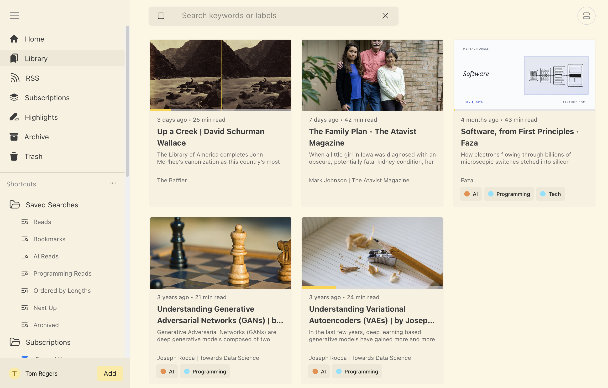
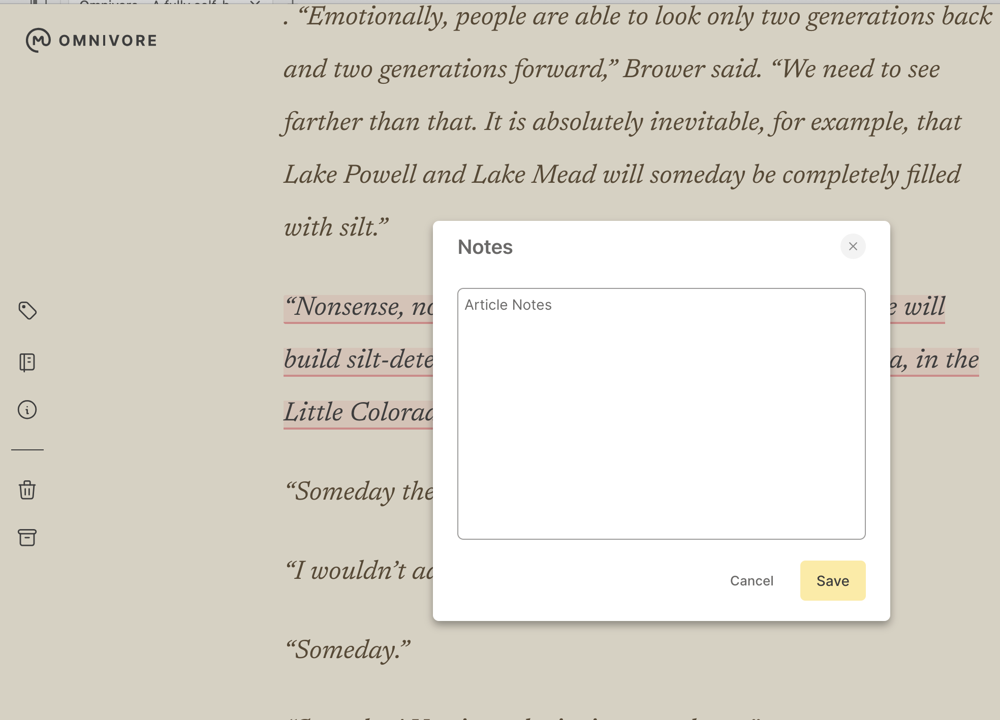
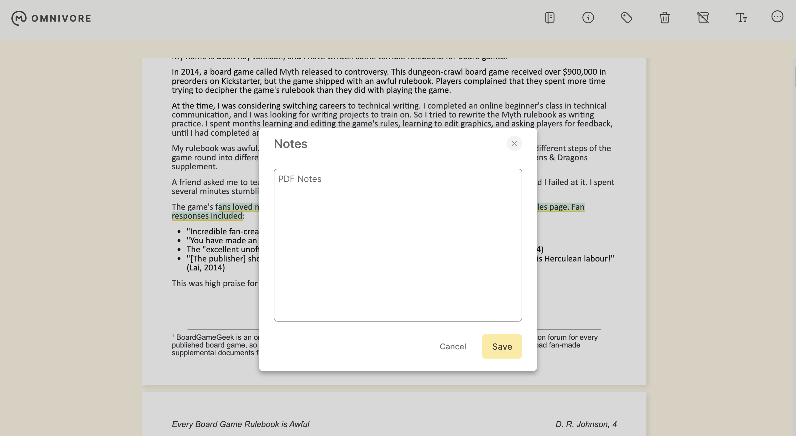
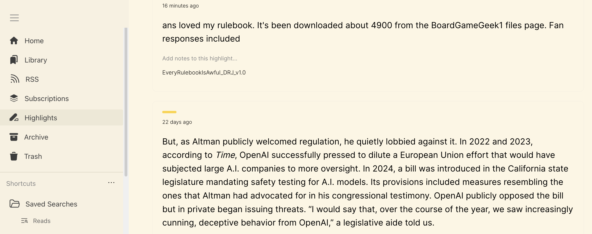
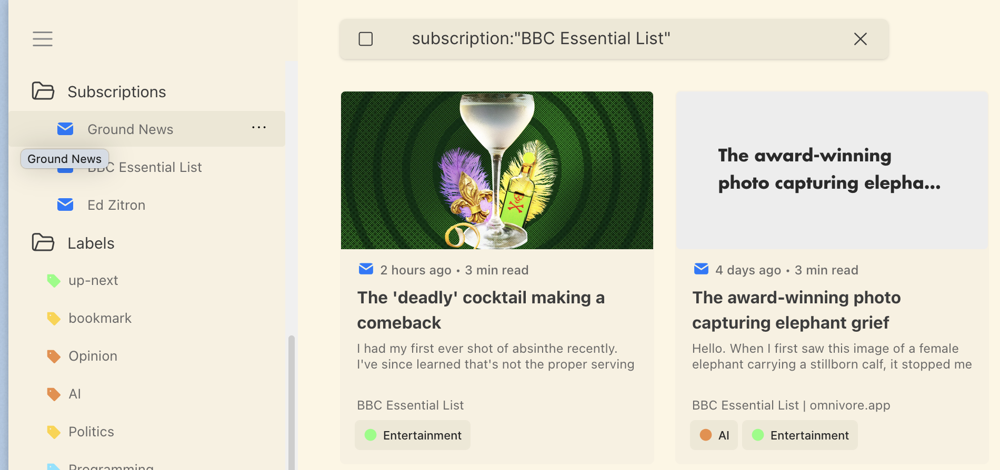
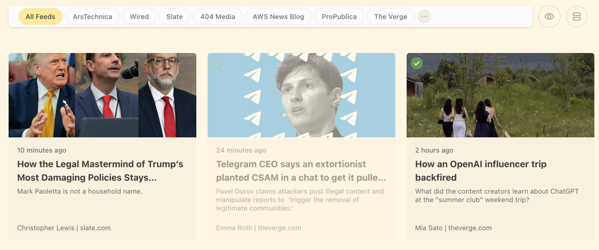
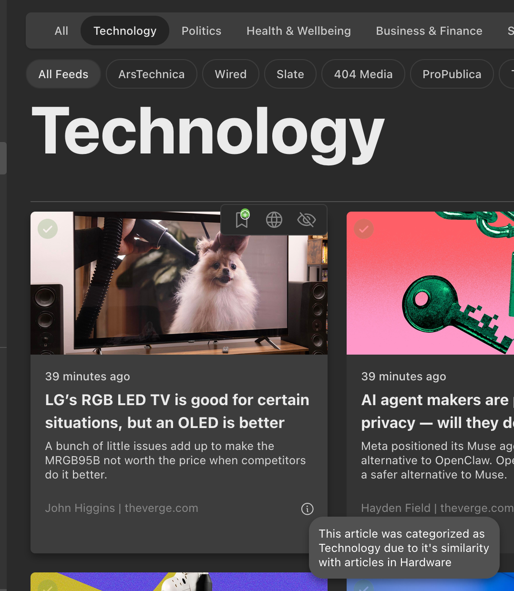
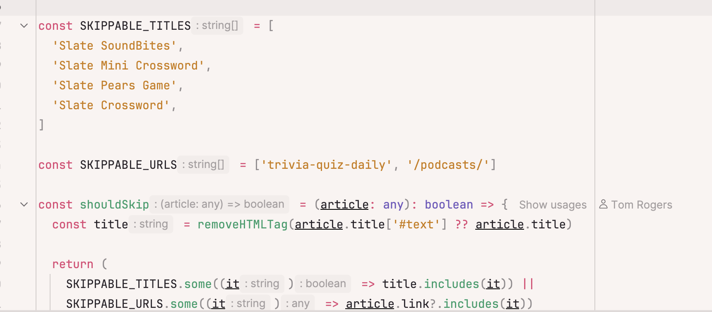
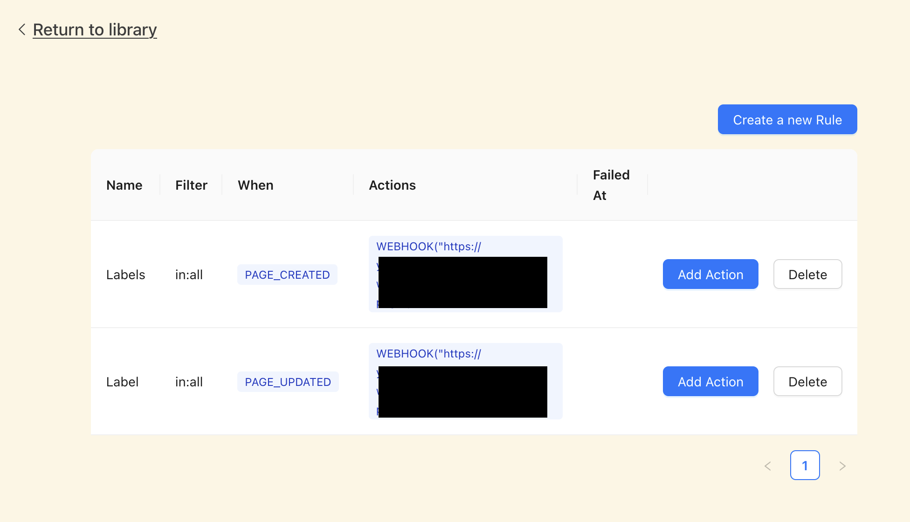

# Omnivore - A fully self-hosted and Open Source Read-it-Later App.

Many of you might be familiar with Omnivore. It was a cloud-hosted Read it Later app that later shutdown due to the owners going to work for ElevenLabs. If you are familiar with it, you'll know that it was a pretty feature-filled reader that became an essential part of peoples reading / articling habit.

Shortly before the shutdown I was tasked with ensuring that Omnivore could live on as a self-hosted application. By the time the Omnivore application shut down there was a fully-self hostable version available.

I didn't do much to advertise this at the time. We had a pretty sturdy community on Discord and those who needed that information found it.

I wanted to advertise it now because I have made a few changes to the setup, and I figured it might be a nice time for people to jump in.

[Link to the Github Repo](https://github.com/omnivore-app/omnivore)

[Link to the Self Hosting Guide](https://github.com/omnivore-app/omnivore/blob/main/self-hosting/GUIDE.md)

## What is it?
Omnivore is predominantly a Read-It-Later app. It takes articles from the web, formats them in a readable way (using readability.js) and syncs them across your devices.

Additional to that it also provides the following features:

* Content Labels for search.
* Highlights, and Notes across articles and PDFs:
    * 
    * 
    * 
* Email Subscription Integrations:
    * 
* RSS Functionality:
    * Full RSS Feed functionality:
        * Full RSS Reader with ability to add to stories, hide stories, or view on the web. 

    * Additional (optional) functionality that allows for automatic categorisation of stories:
        * 
    * The ability to filter (via code) some of the articles within an RSS Feed: For instance, for me, I subscribe to Slate but hate their quizzes and podcasts
        * 
* Android and iOS Applications:
    * Android: [APK](https://github.com/omnivore-app/omnivore/releases/tag/android-0.230.0) and [Code](https://github.com/omnivore-app/omnivore/tree/main/mobile/android/Omnivore)
    * iOS: [Code](https://github.com/omnivore-app/omnivore/tree/main/mobile/apple)
* Web Extensions (Firefox, Chrome):
    * [Chrome](https://chromewebstore.google.com/detail/omnivore-self-hosted/lbikobacedbbjfoglgnildlciiiddcnl?pli=1)
    * [Firefox](https://addons.mozilla.org/en-US/firefox/addon/omnivore-self-hosted/)
* Custom Extractors for Content:
    * Will always scroll to address lazy loaded content
    * Some examples: For some articles on Ars Technica there are paginated pages. The content-parser will make sure we paginate this
    * Some articles have mid-roll ads or other article suggestions. We can ensure that there's these are avoided.
    * Pop-ups etc are stripped away.
* WebHooks for newly added articles and other actions
    * I use this, for instance, for automatically labelling my articles based on embeddings. https://github.com/Podginator/omnivore-automatic-labelling but can be used for a wide variety of stuff.
    * 
* E-Ink Optimised settings (Double tap to turn, Scroll via Volume Buttons):
    * [eink-video.mp4](./guides/images/eink-video.mp4)
## Getting Started:
We have a full guide on getting started on our github here:  [Self-Hosting Guide](https://github.com/omnivore-app/omnivore/blob/main/self-hosting/GUIDE.md). It walks you through getting the application up and running, and also adding the additional pieces of functionality like Email Newsletters, Youtube Transcriptions, RSS auto categorisation etc

It also walks through how to expose it to the web to get it running everywhere.

We also have a discord channel: [Omnivore Discord](https://discord.gg/PqMpyhXNj) Where I post a lot of the changes and am always available to help.

